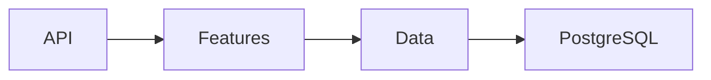

# Vertical Slice Architecture in .NET 10

A focused course-enrolment reference from [Rehan Akbar](https://www.rehanakbar.dev/templates). Free under MIT.

## Prerequisites
.NET SDK 10.0.402 and Docker with Linux containers. Dependencies are pinned and NuGet lockfiles are committed.

## Run

```sh
docker compose up -d --wait
dotnet run --project src/Api --urls http://127.0.0.1:5080
```

In a second terminal:

```sh
curl http://127.0.0.1:5080/health
curl -X POST http://127.0.0.1:5080/courses -H 'Content-Type: application/json' -d '{"title":"Architecture","capacity":1}'
# Substitute the returned course ID. Use the same student ID twice to verify idempotency.
curl -X POST http://127.0.0.1:5080/courses/COURSE_ID/enrollments -H 'Content-Type: application/json' -d '{"studentId":"11111111-1111-4111-8111-111111111111"}'
```

Expect 201 for course creation, 200 for enrolment/replay, 409 when another student exceeds capacity, 400 for invalid data, and 404 for an unknown course. Read the course to see the committed count.

## Verify

```sh
dotnet restore EduCore.slnx --locked-mode
dotnet test EduCore.slnx
# PostgreSQL concurrency tests (PowerShell):
$env:TEST_POSTGRES='Host=localhost;Port=5434;Database=educore_slices;Username=lab;Password=local-only-change-me'
dotnet test EduCore.slnx
```

Without TEST_POSTGRES, HTTP integration tests use SQLite and do not exercise PostgreSQL row locks; the PostgreSQL concurrency cases are reported as skipped and only run with that variable. CI runs both modes.

## Design
Features own request handlers and use the DbContext directly. There is no mediator, generic repository, or mandatory layer stack. Shared entity invariants are small and explicit.



PostgreSQL locks the course row inside an enrolment transaction. The duplicate-student check and capacity check occur while the lock is held; a unique index is a second line of defence. Retrying the same student returns the original enrolment. All SQL inputs are parameters.

## Limits and security
Local educational API, not an authenticated application. Do not expose it publicly without authentication, authorisation, request/rate limits, HTTPS, secret management and an operational review. The shown password is a loopback-only demonstration value, never a production credential. EnsureCreated bootstraps a disposable schema; use reviewed EF migrations for long-lived deployments. No real emails are sent.

## Reset
Stop the API and run `docker compose down -v` to delete this kit's disposable local database. The three .NET kits use the same loopback port, so stop one before running another.

## Licence
MIT; see LICENSE. Dependency licences are listed in docs/dependencies.md.

## Code formatting

Run `dotnet tool restore`, then `dotnet csharpier format .` to format C# and project XML. Run `dotnet csharpier check .` to verify; CI enforces the pinned formatter. The local tool can roll forward to the installed .NET 10 runtime.
